# FEM Lab

**Aplicación web para resolver problemas de ingeniería lineales con el Método de Elementos Finitos (MEF) usando elementos lineales o cuadráticos.**

Proyecto de la materia *Diseño por Elementos Finitos* — Universidad Distrital Francisco José de Caldas, 2026-1.

👉 **Abrir la app: https://mixhaaa.github.io/FEM-Lab-App/**

Funciona en el celular y en el computador, sin instalar nada y sin servidor: todos los cálculos se hacen en el navegador.

<p align="center">
  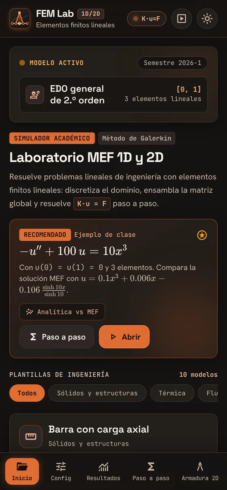
  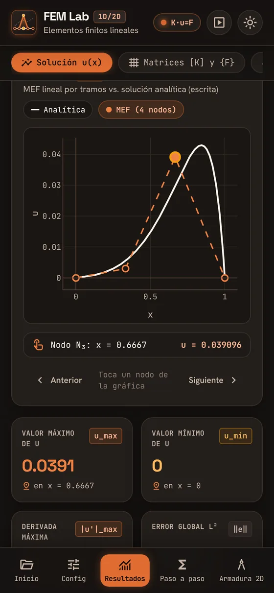
  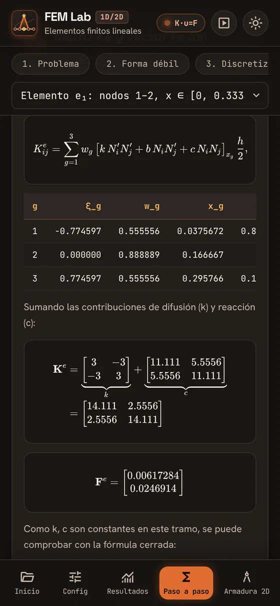
  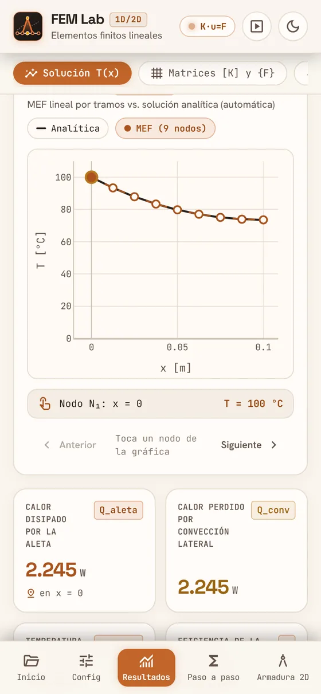
</p>

<p align="center">
  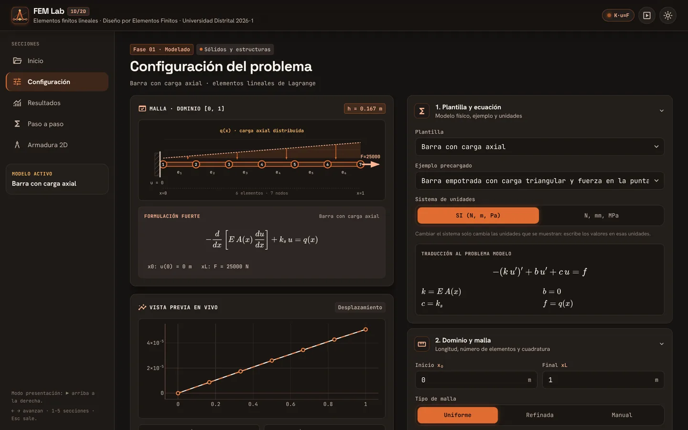
</p>

---

## Contenido

1. [Qué hace](#qué-hace)
2. [Cómo usarla](#cómo-usarla)
3. [El método](#el-método)
4. [Plantillas de ingeniería](#plantillas-de-ingeniería)
5. [Verificación](#verificación)
6. [Desarrollo](#desarrollo)
7. [Más capturas](#más-capturas)

---

## Qué hace

Resuelve el problema modelo 1D

$$
-\frac{d}{dx}\left(k(x)\,\frac{du}{dx}\right) + b(x)\,\frac{du}{dx} + c(x)\,u = f(x), \qquad x \in [x_0,\ x_L]
$$

y armaduras planas y sistemas de resortes por el método de rigidez directa.

| | |
|---|---|
| **Coeficientes** | k, b, c y f se escriben como expresiones en x (`10*x^3`, `2+sin(x)`, `0.001*(1 - x/2)`, constantes, `x <= 0.3 ? 1 : 2`). |
| **Propiedades por tramos** | El dominio se divide en regiones con coeficientes distintos (barra de dos materiales, pared compuesta, …). |
| **Cargas puntuales** | Además de la carga distribuida; se coloca un nodo automáticamente en cada una. |
| **Fronteras** | Dirichlet, Neumann y Robin en cada extremo. |
| **Mallas** | Uniforme, refinada hacia un extremo (geométrica) o con nodos manuales. |
| **Integración** | Cuadratura de Gauss de 1 a 5 puntos por elemento. |
| **Fronteras Dirichlet** | Por eliminación o por penalización (como en el código de clase en MATLAB). |
| **Solución** | Algoritmo de Thomas o eliminación gaussiana con pivoteo. |
| **Posproceso** | Derivada y flujo por elemento, esfuerzos, reacciones en los apoyos, balance global y energía. |
| **Comparación** | Solución analítica escrita por el usuario, o calculada automáticamente si los coeficientes son constantes. |
| **Convergencia** | Error nodal, L² y H¹ con Ne = 2…512, gráfica log-log y orden de convergencia. |
| **Paso a paso** | Formulación débil, funciones de forma, Ke y Fe con los números del problema, ensamblaje, fronteras, solución y posproceso, con fórmulas en KaTeX. |
| **Matrices** | Ke, K global, F y u en tablas, y la estructura de K como el `spy` de MATLAB. |
| **Exportar** | CSV, reporte PDF (memoria de cálculo), código **MATLAB** equivalente y código **Python**. |
| **Presentación** | Pantalla completa, letra grande y control con el teclado para exponer en clase. |

---

## Cómo usarla

1. **Inicio**: elige una plantilla (barra, calor, aleta, …) y uno de sus ejemplos, o abre el **ejemplo de clase** −u″ + 100u = 10x³.
2. **Configuración**: cambia los datos físicos, los tramos, las cargas, las condiciones de frontera, la malla y el método. Cada campo se valida mientras escribes; en el computador, la solución se actualiza en vivo al lado.
3. **Resultados**: gráfica MEF vs analítica (toca un nodo para ver su valor), indicadores principales, tablas, matrices, derivadas, reacciones y convergencia.
4. **Paso a paso**: el procedimiento completo del método con los números de tu problema.
5. **Armadura 2D**: plano interactivo; toca un nodo o una barra para ver sus datos. Las barras se colorean según tracción o compresión y se dibuja la deformada.
6. **Exportar**: al final de Resultados (o de Armadura 2D) están el reporte PDF, los CSV y los códigos MATLAB y Python.
7. **Modo presentación**: botón ▶ arriba a la derecha. Las flechas ← → avanzan en el paso a paso y en las pestañas; 1–5 cambian de sección; Esc sale.

**En el celular** se puede instalar como una app: en Chrome, menú ⋮ → *Agregar a pantalla principal*; en Safari, *Compartir → Agregar a inicio*. El tema claro/oscuro se cambia con el botón ☀/☾.

---

## El método

### 1. Formulación débil

Se multiplica la ecuación por una función de prueba $v$, se integra y se integra por partes el término de segundo orden:

$$
\int_{x_0}^{x_L}\left(k\,u'\,v' + b\,u'\,v + c\,u\,v\right)dx
= \int_{x_0}^{x_L} f\,v\,dx
+ \left.k\frac{\partial u}{\partial n}\,v\right|_{x_0}
+ \left.k\frac{\partial u}{\partial n}\,v\right|_{x_L}
+ \sum_i P_i\,v(x_i)
$$

donde $\partial u/\partial n$ es la derivada según la **normal exterior** ($n = -1$ en $x_0$, $n = +1$ en $x_L$).

### 2. Condiciones de frontera

| Tipo | Condición | Qué se hace |
|---|---|---|
| Dirichlet (esencial) | $u = \bar u$ | $v = 0$ en ese extremo; se impone al final (eliminación o penalización) |
| Neumann (natural) | $k\,\partial u/\partial n = q$ | $F_{\text{ext}} \mathrel{+}= q$ |
| Robin (natural) | $k\,\partial u/\partial n + h\,u = g$ | $K_{\text{ext}} \mathrel{+}= h,\quad F_{\text{ext}} \mathrel{+}= g$ |

Con esta convención un valor positivo de $q$ siempre significa que *entra* al dominio: una fuerza hacia $+x$ en una barra, calor que entra a una pared, caudal que entra a una tubería. Las plantillas hacen esta traducción por ti (por ejemplo, la convección se escribe con $h$ y $T_\infty$).

### 3. Elemento lineal

En el elemento $e$, con nodos $x_1$, $x_2$ y $h = x_2 - x_1$:

$$
N_1(x) = \frac{x_2 - x}{h}, \qquad N_2(x) = \frac{x - x_1}{h}, \qquad N_1' = -\frac{1}{h}, \qquad N_2' = \frac{1}{h}
$$

Con la coordenada natural $\xi \in [-1, 1]$: $x = \tfrac{x_1+x_2}{2} + \tfrac{h}{2}\xi$ y $dx = \tfrac{h}{2}\,d\xi$.

### 3b. Elemento cuadrático (opcional)

En Configuración → *Tipo de elemento* se elige **Cuadrático · 3 nodos**. Cada elemento agrega un nodo en su centro $x_2 = \tfrac{x_1 + x_3}{2}$ y la solución es una parábola dentro del elemento:

$$
N_1 = \tfrac{1}{2}\,\xi(\xi - 1), \qquad N_2 = 1 - \xi^2, \qquad N_3 = \tfrac{1}{2}\,\xi(\xi + 1), \qquad \frac{dN_i}{dx} = \frac{dN_i}{d\xi}\,\frac{2}{h}
$$

Con coeficientes constantes:

$$
\mathbf{K}^e = \frac{k}{3h}\begin{bmatrix}7&-8&1\\-8&16&-8\\1&-8&7\end{bmatrix} + \frac{b}{6}\begin{bmatrix}-3&4&-1\\-4&0&4\\1&-4&3\end{bmatrix} + \frac{c\,h}{30}\begin{bmatrix}4&2&-1\\2&16&2\\-1&2&4\end{bmatrix}, \qquad \mathbf{F}^e = \frac{f\,h}{6}\begin{bmatrix}1\\4\\1\end{bmatrix}
$$

Los nodos se numeran en orden de $x$ (inicio, centro, fin, centro, …), así que $K$ queda con 5 diagonales y se resuelve con eliminación gaussiana en banda (Thomas solo sirve para 3 diagonales). Se recomiendan al menos 3 puntos de Gauss y el máximo es 1000 elementos.

### 4. Matriz y vector elementales (cuadratura de Gauss)

$$
K^{e}_{ij} = \sum_{g} w_g\left[k\,N_i'N_j' + b\,N_i N_j' + c\,N_i N_j\right]_{x_g}\frac{h}{2},
\qquad
F^{e}_{i} = \sum_{g} w_g\,f(x_g)\,N_i(x_g)\,\frac{h}{2}
$$

Con $n$ puntos de Gauss se integran exactamente polinomios de grado $2n-1$ (por defecto se usan 3). Si los coeficientes son constantes se obtiene la forma cerrada:

$$
\mathbf{K}^e = \frac{k}{h}\begin{bmatrix}1&-1\\-1&1\end{bmatrix}
+ \frac{b}{2}\begin{bmatrix}-1&1\\-1&1\end{bmatrix}
+ \frac{c\,h}{6}\begin{bmatrix}2&1\\1&2\end{bmatrix},
\qquad
\mathbf{F}^e = \frac{f\,h}{2}\begin{bmatrix}1\\1\end{bmatrix}
$$

### 5. Ensamblaje, fronteras y solución

Cada $\mathbf{K}^e$ se suma en las filas y columnas de sus nodos globales, con lo que $\mathbf{K}$ queda tridiagonal. Luego:

- **Cargas puntuales y fronteras naturales**: se suman a $\mathbf{F}$ (y a la diagonal de $\mathbf{K}$ en Robin).
- **Dirichlet por eliminación**: se quitan las filas y columnas de los nodos prescritos y se pasa $K_{id}\,\bar u_d$ al lado derecho.
- **Dirichlet por penalización**: $K_{dd} \mathrel{+}= \beta$, $F_d \mathrel{+}= \beta\,\bar u_d$, con $\beta = 10^{p}\max_i|K_{ii}|$ ($p = 8$ por defecto).
- **Solución**: algoritmo de Thomas si $\mathbf{K}$ es tridiagonal y diagonalmente dominante; si no, eliminación gaussiana con pivoteo parcial.

### 6. Posproceso

$$
u'_e = \frac{u_{2} - u_{1}}{h}, \qquad \text{flujo}_e = k(x_m)\,u'_e, \qquad R_d = \left(\mathbf{K}\mathbf{u} - \mathbf{F}\right)_d
$$

Las reacciones se calculan con la matriz *antes* de imponer Dirichlet. El **balance global** suma todo lo que entra al dominio (carga distribuida, cargas puntuales, flujos de frontera, reacciones y los términos $-\int c\,u\,dx$, $-\int b\,u'\,dx$) y debe dar ≈ 0.

### 7. Error y convergencia

Con la solución analítica $u$:

$$
\max_i|u_i - u(x_i)|, \qquad \|u-u_h\|_{L^2} = \left(\int (u-u_h)^2dx\right)^{1/2}, \qquad |u-u_h|_{H^1} = \left(\int (u'-u_h')^2dx\right)^{1/2}
$$

Para elementos lineales se espera $\|e\|_{L^2} \sim h^2$ y $|e|_{H^1} \sim h$; para cuadráticos $\|e\|_{L^2} \sim h^3$, $|e|_{H^1} \sim h^2$ y en los nodos aproximadamente $h^4$. El estudio de convergencia resuelve con $N_e = 2, 4, 8, \dots$ y ajusta la pendiente de $\log e$ contra $\log h$. La app avisa los casos especiales: **superconvergencia** nodal (con $k$ constante y $b = c = 0$ los nodos son exactos) y **solución exacta en la malla** (solución lineal por tramos).

### 8. Armadura plana y resortes

$$
\mathbf{k}^e = \frac{EA}{L}\begin{bmatrix} c^2 & cs & -c^2 & -cs\\ cs & s^2 & -cs & -s^2\\ -c^2 & -cs & c^2 & cs\\ -cs & -s^2 & cs & s^2\end{bmatrix},
\qquad N = \frac{EA}{L}\begin{bmatrix}-c & -s & c & s\end{bmatrix}\mathbf{u}^e,
\qquad \sigma = \frac{N}{A}
$$

con $c = \cos\theta$ y $s = \sin\theta$. Para resortes, $\mathbf{k}^e = k\begin{bmatrix}1&-1\\-1&1\end{bmatrix}$ y $f = k\,(u_j - u_i)$.

---

## Plantillas de ingeniería

Cada plantilla traduce las variables físicas a $k, b, c, f$ y muestra los resultados con su nombre y unidad. Las estructurales admiten SI (N, m, Pa) o N·mm·MPa.

| Plantilla | $k$ | $c$ | $f$ | Resultados |
|---|---|---|---|---|
| Barra con carga axial | $E\,A(x)$ | $k_s$ (medio elástico) | $q(x)$ | $u$, $\varepsilon$, $\sigma = E\,u'$, $N = EA\,u'$, reacciones |
| Conducción de calor 1D | $k\,A$ | 0 | $\dot q\,A$ | $T$, flujo $q'' = -k\,T'$, calor por cada extremo |
| Aleta con convección | $k\,A_c(x)$ | $h\,P(x)$ | $h\,P\,T_\infty$ | $T$, calor disipado, eficiencia, efectividad |
| Cable o cuerda tensa | $T$ | $k_f$ (base elástica) | $p(x)$ | flecha $w$, pendiente, fuerza transversal |
| Flujo en medio poroso (Darcy) | $K\,A$ | 0 | recarga $r(x)$ | carga hidráulica, velocidad de Darcy, caudal |
| Flujo laminar en tubería | $\pi D^4/(128\,\mu)$ | 0 | $q_l(x)$ | presión, caudal, velocidad media, Reynolds |
| Electrostática 1D | $\varepsilon_0\,\varepsilon_r$ | 0 | $\rho(x)$ | potencial, campo $E$, desplazamiento $D$, capacitancia |
| EDO general | $k(x)$ | $c(x)$ | $f(x)$ | $u$, $u'$, $k\,u'$ (también admite $b(x)$) |
| Armadura plana 2D | — | — | — | desplazamientos, fuerzas axiales, esfuerzos, reacciones, deformada |
| Sistema de resortes | — | — | — | desplazamientos, fuerza en cada resorte, reacciones |

Hay **31 ejemplos precargados**, entre ellos el ejemplo de clase, la barra de dos materiales, la pared ladrillo + aislante, la aleta de pin, el acuífero con recarga, el capacitor de dos dieléctricos y la armadura Pratt de 4 paneles.

---

## Verificación

El proyecto tiene **174 pruebas automáticas** (Vitest) que se ejecutan antes de cada publicación. Las que corren el código exportado necesitan GNU Octave y Python con NumPy; si no están instalados, se omiten. Entre ellas:

| Prueba | Resultado esperado |
|---|---|
| Ejemplo de clase, Ne = 3 | $u \approx [0,\ 0.0030,\ 0.0391,\ 0]$; Ke, K, F y reacciones iguales a una referencia en NumPy con 10–12 cifras |
| Convergencia del ejemplo de clase | orden nodal 2.00, L² 2.00, H¹ 1.00 |
| Barra con carga uniforme | $u$ exacta en los nodos, reacción $-(qL + P)$ |
| Calor con generación y convección | $T$ exacta en los nodos y balance de calor |
| Aleta adiabática | $\eta = \tanh(mL)/(mL)$ y $Q = \sqrt{hPkA}\,\theta_b\tanh(mL)$ |
| Armaduras de dos barras y triángulo isostático | fuerzas del método de los nudos y reacciones |
| Fronteras Dirichlet, Neumann y Robin; tramos; cargas puntuales | soluciones exactas |
| Eliminación vs penalización; Thomas vs Gauss | mismos resultados |
| **Código exportado** | El `.m` y el `.py` de **todos** los ejemplos se ejecutan en GNU Octave y en Python y reproducen los resultados de la app |

Para comprobarlo en tu computador:

```bash
npm install
npm test                       # todas las pruebas
npm run demo:clase             # ejemplo de clase: Mnod, Melem, Ke, Kglob, Vglob y u
npm run demo:clase -- 6        # el mismo ejemplo con 6 elementos
npm run demo:plantillas        # todos los ejemplos con sus resultados principales
```

---

## Desarrollo

Requiere Node.js 20 o superior.

```bash
npm install
npm run dev          # servidor de desarrollo en http://localhost:5173
npm test             # pruebas
npm run build        # versión de producción en dist/
npm run iconos       # actualiza la fuente de íconos si se agregan íconos nuevos
```

**Tecnología**: React + Vite + TypeScript, Tailwind CSS, math.js (lectura de expresiones), Plotly (gráficas), KaTeX (fórmulas) y Zustand (estado). La app es estática y se publica en GitHub Pages con GitHub Actions en cada cambio en `main` (primero corren las pruebas).

```
src/core/        Núcleo de cálculo (TypeScript puro, independiente de la interfaz):
                 expresiones, malla, Gauss, elementos lineal y cuadrático, ensamblaje, fronteras,
                 solucionadores, posproceso, convergencia, solución analítica,
                 armadura 2D y resortes
src/templates/   Plantillas: variables físicas → k, b, c, f, y resultados con nombre y unidad
src/export/      CSV, código MATLAB/Octave y código Python
src/ui/          Interfaz: páginas, componentes, estado, tema y modo presentación
tests/           Pruebas con Vitest contra soluciones analíticas
scripts/         Demostraciones en la terminal y descarga de íconos
docs/capturas/   Capturas de este README
```

**Diseño**: sistemas *Sahara Nocturne* (tema oscuro) y *Sahara Warm Minimalism* (tema claro), diseñados en Google Stitch. Las fuentes (Space Grotesk, Hanken Grotesk y JetBrains Mono) y los íconos van incluidos en la app, así que funciona sin conexión una vez cargada.

---

## Más capturas

<p align="center">
  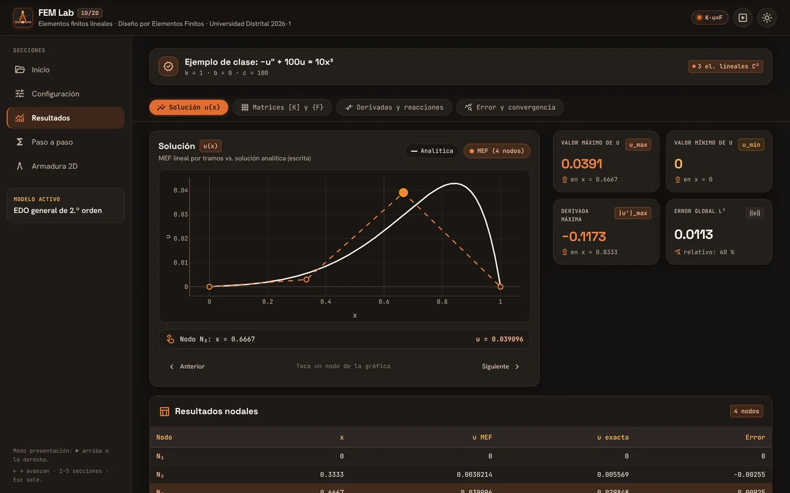<br>
  <em>Resultados: MEF vs analítica e indicadores principales</em>
</p>

<p align="center">
  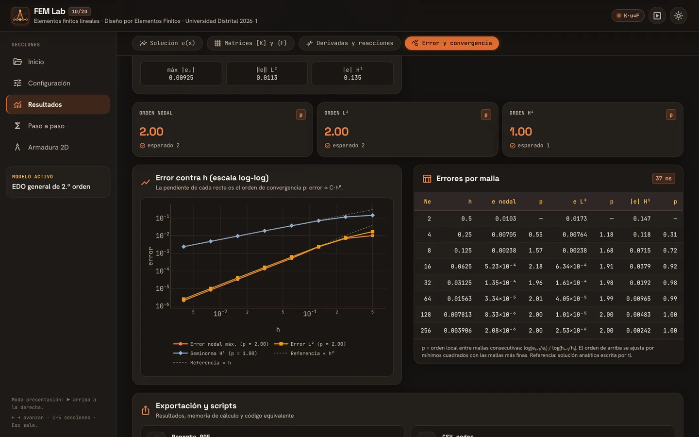<br>
  <em>Estudio de convergencia: error contra h en escala log-log</em>
</p>

<p align="center">
  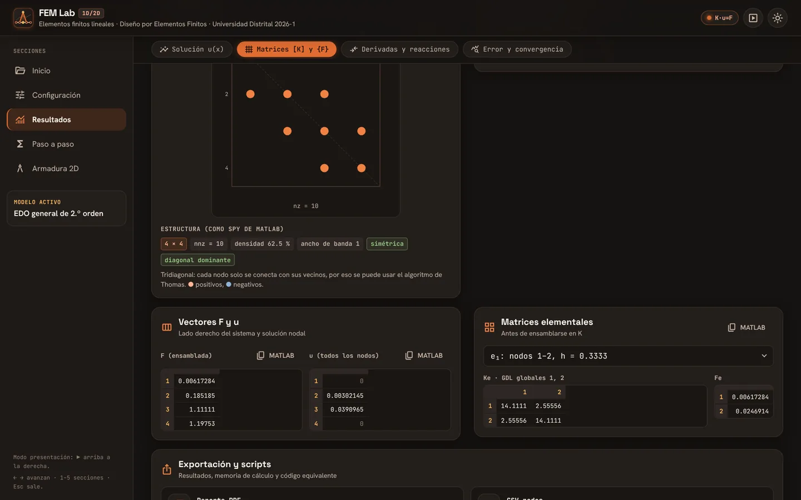<br>
  <em>Matriz global, estructura tipo spy y copia en formato MATLAB</em>
</p>

<p align="center">
  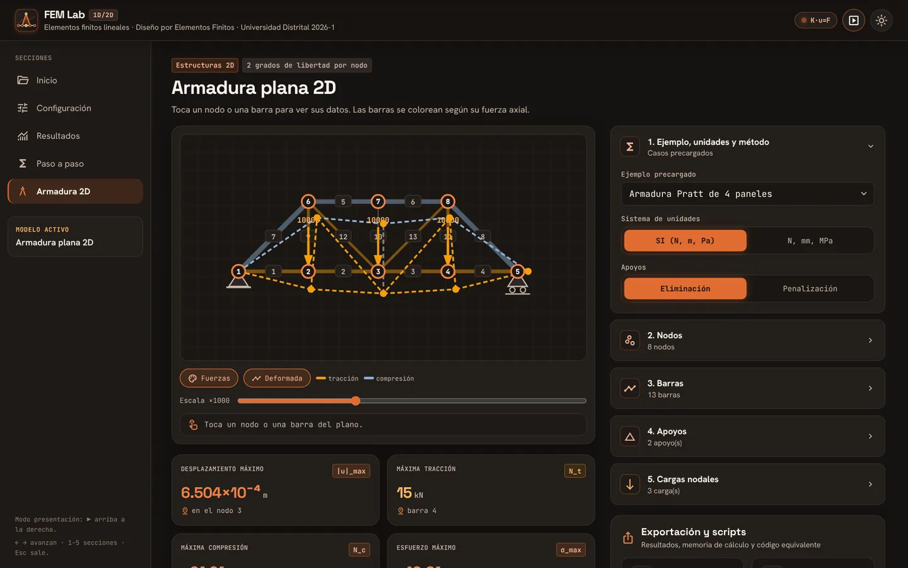<br>
  <em>Armadura Pratt: fuerzas por color y deformada</em>
</p>

<p align="center">
  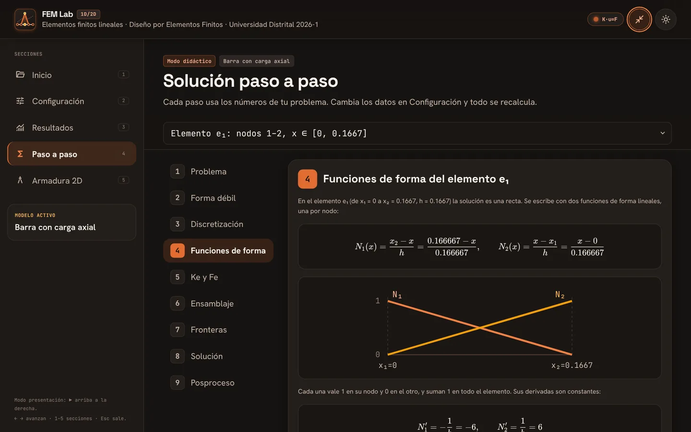<br>
  <em>Modo presentación con el paso a paso</em>
</p>

<p align="center">
  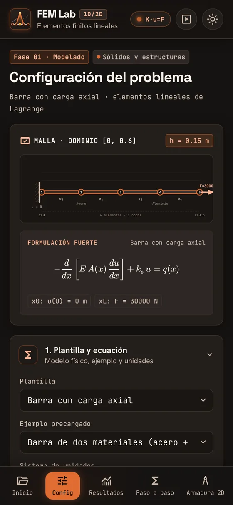
  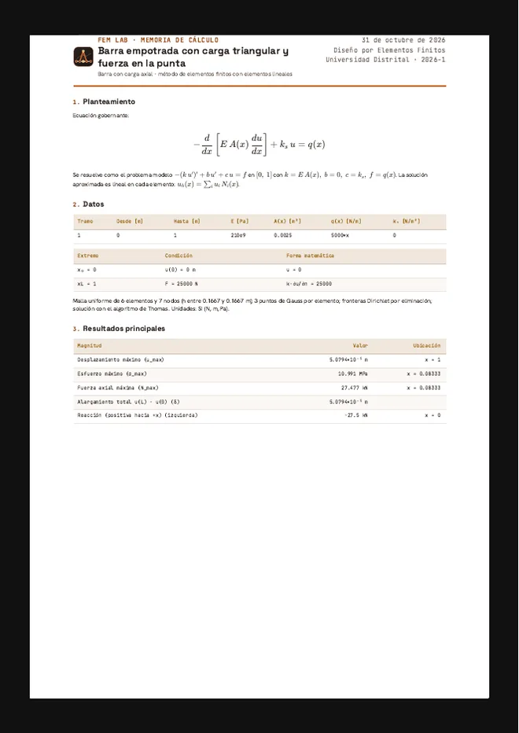<br>
  <em>Configuración en el celular y primera página del reporte PDF</em>
</p>

---

*Diseño por Elementos Finitos · Universidad Distrital Francisco José de Caldas · 2026-1*
